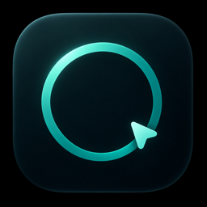
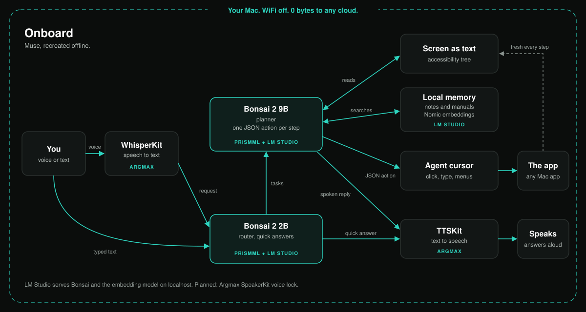

<p align="center"></p>

# Onboard

**Muse, recreated offline.** A personal agent that lives on your Mac, sees the app in front of you, acts with its own cursor, and answers out loud, with WiFi off.

Built for the Local AI Hackathon at Cornell (theme: RECREATE). Language is PrismML Bonsai 2. Voice is Argmax.

## At a glance

| | |
|---|---|
| **Fully on the Mac** | Cloud voice assistants and cloud computer-use agents send your screen and your voice to a data center. Onboard does the same job on the Mac itself. |
| **Works with WiFi off** | Every model runs locally. The app shows "0 B to cloud", and "turn the WiFi off" is something you can ask it to do. |
| **Thinks with Bonsai** | Bonsai 2 9B plans every step and checks the result (with vision). Bonsai 2 2B gives quick answers. Both are served by LM Studio. |
| **Hears and speaks with Argmax** | WhisperKit hears, SpeakerKit recognizes the owner's voice, TTSKit speaks. |
| **Where it matters** | On a plane, in a lab or field site with no signal, in a clinic or law office where the screen cannot leave the building, and for anyone who relies on voice control and cannot lose it when the network drops. |
| **Usable by voice alone** | Wake word, spoken answers, voice cancel, and a voice lock so only the owner is obeyed. |

## Why offline

A radio signal to Mars takes up to 24 minutes each way. A crew member who asks Earth a question waits 40 minutes or more for the answer. NASA is testing an onboard medical assistant (CMO-DA, built with Google) for this reason, and CIMON, the assistant on the ISS, needed a cloud server in Frankfurt to think. An assistant that depends on a data center does not make the trip.

The same holds on Earth for anyone who cannot send their data to a cloud (lawyers, doctors), or does not want to pay for one.

## What it does

- **Type or talk.** Press Option-Space and type, or hold fn and speak.
- **Reads the screen as text.** It walks the macOS accessibility tree of the front window, which is exact and fast.
- **Works across apps.** One request can read a value in one app and write it in another. What it reads is kept by the harness across the switch, and a number it never actually read is refused before it is typed.
- **Looks at what text cannot describe.** Ask about a chart, an image or an error dialog and Bonsai 2 9B answers from a picture of the window.
- **Rewrites your selection in place.** Select text in any app and say "make this formal": the selection is replaced and read back to confirm.
- **Does file work directly.** "Put every PDF from Downloads into a folder called Receipts" lists and moves the files after you approve, with no clicking through Finder.
- **Has eyes as a backup.** When an app exposes almost nothing, Onboard takes a picture of the window, reads the text in it with Apple's on-device recognizer, and clicks what it read. Before it says a task is done, Bonsai 2 9B looks at a picture of the window (its vision tower, loaded locally) and confirms the result is really there.
- **Acts with its own cursor.** A teal cursor glides to the exact button, x-rays the window, clicks and types through the task, and leaves numbered step dots. Your own pointer stays where it was.
- **Answers out loud**, in one or two short sentences.
- **Searches your notes and manuals** on disk with local embeddings, and names the file the answer came from.
- **Asks before risky actions.** An email draft shows an approval card first, and Onboard never presses Send.
- **Dictates anywhere.** Hold fn + Control and speak into any app.
- **Hands-free.** Say "Onboard, ..." and it starts, or say "Onboard" on its own and then the request. No keys at all.
- **Voice lock.** A one minute guided training teaches it your voice. After that it obeys only its owner, and anyone else is turned away.
- **Say "cancel".** While it works or talks, "cancel", "stop" or "never mind" stops it and clears the screen.
- **Passes messages on.** "Ask this chat what the project does" types the question into the app in front and sends it.
- **Flips the WiFi.** "Turn the WiFi off" does it, and Onboard keeps working.
- **Asks instead of guessing.** "Remind me" with nothing after it gets a question back, not an invented reminder.
- **Knows your words.** A plain text vocabulary file teaches the recognizer your names and tools.

## How it works



```
+------------------- Your Mac. WiFi off. 0 bytes to any cloud. -------------------+
|                                                                                 |
|                              +--> Screen as text (accessibility tree) <--+      |
|                              |                                           |      |
|                 Bonsai 2 9B <+--> Local memory (notes, manuals, Nomic)   |      |
|                 planner      |                                           |      |
|                 one JSON ----+--> Agent cursor (click, type, menus) --> App     |
|                 action/step  |                                                  |
|                     ^        +--> TTSKit --> speaks                             |
|                     | tasks            ^                                        |
|  You --> WhisperKit --> Bonsai 2 2B ---+ quick answers                          |
|  (voice or text)        router                                                  |
|                                                                                 |
+---------------------------------------------------------------------------------+
```

One turn:

1. WhisperKit turns speech into text (typed text skips this).
2. Onboard reads the front window through the accessibility tree and writes it out as a short numbered list: `[12] button "Save"`, `[13] field "Subject"`.
3. Bonsai 2 9B gets the request, that list, and the steps taken so far, and returns one JSON action: `answer`, `point`, `click`, `type`, `menu`, `key`, `open_app`, `search_memory`, `add_reminder`, `add_event` or `draft_email`.
4. Onboard performs the action with its own cursor, then reads the screen again from scratch.
5. When the model chooses `answer`, TTSKit speaks the reply.

## Models and their jobs

| Sponsor | Model | Job in Onboard |
|---|---|---|
| PrismML | Bonsai 2 9B (ternary, GGUF Q2_0) | Planner. Picks one constrained JSON action per step. |
| PrismML | Bonsai 2 2B (ternary, GGUF Q2_0) | Router and quick replies. |
| Argmax | WhisperKit | Hears you: large-v3 turbo for requests and dictation, base.en for the always-on wake word. |
| Argmax | TTSKit | Speaks the answer. |
| Argmax | SpeakerKit | Recognizes the owner's voice (voice lock). |
| Nomic | nomic-embed-text v1.5 | Embeds notes and manuals for memory search. |

LM Studio serves both Bonsai models and the embedding model on localhost. The Argmax kits run in process.

## Measured numbers

Measured on an M4 Pro MacBook Pro, WiFi off.

| What | Number |
|---|---|
| A simple request end to end (a reminder or a calendar event) | about 3 s |
| Bonsai 2 9B, one agent step on a screen it has already read | about 2 to 3 s |
| Bonsai 2 9B, one agent step after the screen changed | about 8 to 10 s |
| Bonsai 2 9B generation speed | about 53 tokens/s |
| Bonsai 2 2B, one quick reply | about 0.35 s |
| Bonsai 2 2B generation speed | about 145 tokens/s |
| Bytes sent to any cloud | 0 |

## Run it

Requires macOS 15 or later on Apple silicon, Xcode command line tools, and [LM Studio](https://lmstudio.ai) with its `lms` command.

1. While online, download the models once. Use `lms get` to fetch the prism-ml Ternary-Bonsai-2 9B and 2B GGUF files (Q2_0), and the Nomic embedding model:

   ```sh
   lms get prism-ml/Ternary-Bonsai-2-9B-gguf
   lms get prism-ml/Ternary-Bonsai-2-2B-gguf
   lms get nomic-ai/nomic-embed-text-v1.5-GGUF
   ```

2. Load them and start the local server:

   ```sh
   lms load ternary-bonsai-2-9b --identifier bonsai2-9b --gpu max -c 8192 -y   # put Ternary-Bonsai-2-9B-mmproj-Q8_0.gguf next to the model file for vision
   lms load ternary-bonsai-2-2b --identifier bonsai2-2b --gpu max -c 8192 -y
   lms load text-embedding-nomic-embed-text-v1.5
   lms server start
   ```

3. Build the app:

   ```sh
   ./make_app.sh
   ```

4. Open the app from `build/`, then grant **Accessibility**, **Microphone** and **Screen Recording** in System Settings, Privacy and Security. The first launch downloads the WhisperKit and TTSKit models.
5. Put notes and manuals (`.md` or `.txt`) in `~/Library/Application Support/Onboard/memory/`.
6. Turn WiFi off.

## Hotkeys

| Keys | What happens |
|---|---|
| Option-Space | Open the command bar and type a request |
| Hold fn | Talk to Onboard, release to send |
| Hold fn + Control | Dictate into whatever app is in front |
| Say "Onboard, ..." | Hands-free request (turn on Always listening in settings) |
| Say "cancel" | Stop the current run or the spoken answer |
| Option-Space during a run | Stop and clear everything on screen |

## Design choices for small models

A 9B ternary model can drive a computer if the job is shaped to fit it.

- **Screen as text first, pixels second.** The accessibility tree gives exact labels and frames. The model reads a list of at most 70 elements, so a decision stays fast. Pictures are used where they pay: recognized text fills in for apps with an empty tree (about 0.15 s), and one look by Bonsai's vision tower checks the finished work (about 3 to 5 s).
- **Fresh grounding every step.** Each step gets a new read of the screen plus a short list of steps so far. The model never has to hold a long conversation or remember what the screen used to look like.
- **Enum-constrained element ids.** The JSON schema for each step lists only the element numbers on screen right now. The model cannot click something that is not there.
- **Thinking off.** Bonsai 2 reasons by default and can spend thousands of tokens on it. An empty think block as a prefill turns that off, and the constrained schema carries the structure.
- **Two model sizes.** The 2B model handles routing and quick replies in about a third of a second. The 9B model is used only where planning needs it.
- **Menus first.** Every enabled menu bar command is read as a path such as `Format > Font > Bold`. Commands that match the request are passed as hints, and they are pressed through accessibility, which is more reliable than hunting for toolbar buttons.

## Limits

- Models download once while online. After that, nothing needs a network.
- Apps with poor accessibility labels (some Electron apps, canvas-based tools, games) are driven from recognized text only, so controls that are icons without words stay out of reach.
- Multi-step tasks are bounded to 14 steps. A failed action is never repeated, and looking and searching are capped at two each.
- A step that follows a screen change takes 8 to 10 seconds, so long tasks across several apps are slow.
- In a terminal, Onboard presses return on what it typed without asking first. Sending in Messages or Mail and moving files still ask.
- Memory search reads `.md` and `.txt` files only.

## Repo map

| Path | What is there |
|---|---|
| `Sources/OnboardCore` | Agent loop, screen reader, Bonsai client, memory index, speech in and out |
| `Sources/OnboardOverlay` | Agent cursor, x-ray, step dots, approval card |
| `Sources/OnboardUI` | Command bar and voice pill |
| `demo/VIDEO_SCRIPT.md` | Demo video script |
| `docs/DEMO.md` | Video shot list and live demo plan |
| `docs/design-spec.md` | Visual and motion spec |

## Credits

- [PrismML](https://prismml.com) for the Bonsai 2 ternary models.
- [Argmax](https://www.argmaxinc.com) for WhisperKit, TTSKit and SpeakerKit (`argmax-oss-swift` 1.1.1).
- [LM Studio](https://lmstudio.ai) for the local model server.
- [Nomic](https://www.nomic.ai) for the embedding model.
- Inspired by Muse. Built at the Local AI Hackathon at Cornell.
